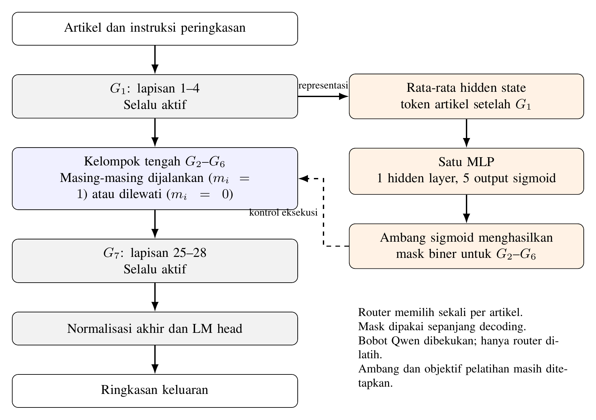

# Dokumen Induk Penelitian

> **Fungsi dokumen:** acuan mandiri yang merangkum identitas, masalah penelitian, sumber ilmiah, desain eksperimen, keputusan, dan hal yang masih belum diputuskan. Dokumen ini memuat seluruh substansi penelitian yang telah ditetapkan serta bagian-bagian yang masih perlu diputuskan.

## 1. Identitas dan ringkasan penelitian

**Judul Indonesia:** Sequence-Level Routing untuk Efisiensi Inferensi Qwen3-0.6B pada Peringkasan Berita Bahasa Indonesia
**Judul Inggris:** Sequence-Level Routing for Efficient Qwen3-0.6B Inference in Indonesian News Summarization

**Gagasan inti:** menguji apakah pemilihan kelompok lapisan secara adaptif satu kali per artikel (sequence-level routing) mengubah kualitas ringkasan dan waktu inferensi Qwen3-0.6B untuk peringkasan berita bahasa Indonesia. Penelitian mengukur kualitas dan waktu aktual, termasuk overhead router. Penelitian tidak mengasumsikan routing atau LoRA pasti unggul.

**Inti masalah:** melewati lapisan dapat mengurangi komputasi, tetapi berpotensi mengubah kualitas; router juga menambah biaya komputasi. Jumlah lapisan yang dilewati sendiri tidak membuktikan percepatan praktis. Efek routing perlu diukur bersama kualitas ringkasan, waktu total inferensi, serta pembanding yang konsisten.

## 2. Pertanyaan penelitian dan tujuan

### Rumusan masalah

1. Bagaimana pengaruh sequence-level routing terhadap kualitas ringkasan dan waktu inferensi Qwen3-0.6B pada XL-Sum Indonesia?
2. Apakah routing adaptif dengan LoRA memberikan trade-off kualitas–efisiensi yang lebih baik daripada pelompatan lapisan statis dan model penuh dengan LoRA, serta bagaimana hasil routing adaptif berubah ketika LoRA tidak digunakan?

### Tujuan

1. Menganalisis pengaruh sequence-level routing terhadap kualitas ringkasan dan waktu inferensi Qwen3-0.6B pada XL-Sum Indonesia.
2. Membandingkan trade-off kualitas–efisiensi routing adaptif+LoRA dengan static skipping+LoRA dan model penuh+LoRA, serta mengukur perubahan hasil routing adaptif melalui kontrol tanpa LoRA.

### Hipotesis

Penelitian ini **tidak menetapkan hipotesis berarah** bahwa routing atau LoRA akan lebih unggul. Fokusnya adalah pengukuran empiris trade-off kualitas dan efisiensi pada rancangan yang ditetapkan. Jangan mengubah pertanyaan penelitian menjadi klaim keunggulan yang diasumsikan.

## 3. Latar belakang dan posisi penelitian

Model bahasa kausal menghasilkan token secara autoregresif; komputasi lapisan Transformer berulang saat membentuk setiap token keluaran. Layer skipping dapat mengurangi komputasi, baik dengan pola lapisan yang sama untuk semua masukan (statis) maupun dengan jalur yang menyesuaikan artikel (adaptif). Kecepatan dinding aktual dapat dipengaruhi overhead routing, prefill, decoding, dan implementasi cache, sehingga perlu diukur langsung.

Penelitian memusatkan kajian pada **sequence-level routing**: satu keputusan route dibuat dari representasi artikel setelah kelompok pertama, lalu dipertahankan selama pemrosesan prompt yang tersisa dan seluruh decoding. Unit keputusan adalah masing-masing kelompok lapisan tengah, bukan satu kelas route yang dipilih dari daftar kandidat tetap.

Posisi penelitian: penerapan pada Qwen3-0.6B dan peringkasan berita Indonesia menggunakan XL-Sum; evaluasi tiga pendekatan utama (penuh, statis, adaptif) dengan LoRA serta kontrol adaptif tanpa LoRA; pengukuran kualitas dan waktu aktual. Penelitian ini tidak mengklaim sebagai penerapan pertama.

## 4. Paper dan sumber rujukan

Rangkuman berikut menjelaskan temuan dan fungsi setiap sumber bagi rancangan penelitian. Tautan mengarah ke laman penerbit atau sumber resmi.

| Sumber | Informasi utama | Relevansi dan batas pemakaian |
|---|---|---|
| Jain et al. (2025), [FiRST](https://aclanthology.org/2025.findings-emnlp.1197/), *Finetuning Router-Selective Transformers for Input-Adaptive Latency Reduction* | Router memilih lapisan secara adaptif pada tahap prefill; pola dua tahap membekukan backbone saat melatih router, lalu membekukan router dan melatih LoRA pada attention dan FFN. | Preseden paling dekat untuk pola pelatihan dua tahap. Riset ini mengadaptasi gagasan tersebut pada satu router kelompok lapisan dan tugas XL-Sum Indonesia. |
| Wee, Park, & Lee (2025), [PuDDing](https://proceedings.mlr.press/v267/wee25a.html), *Prompt-based Depth Pruning of Large Language Models* | Router ringan memilih omission set berbasis prompt dari opsi yang dibentuk secara data-driven; diuji pada benchmark penalaran akal sehat. | Mendukung relevansi routing berbasis prompt; bukan bukti efektivitas pada peringkasan berita Indonesia. Rancangan penelitian ini menggunakan lima keputusan biner kelompok tengah. |
| Hasan et al. (2021), [XL-Sum](https://aclanthology.org/2021.findings-acl.413/), *Large-Scale Multilingual Abstractive Summarization for 44 Languages* | Dataset pasangan artikel berita dan ringkasan abstraktif dalam 44 bahasa, termasuk Indonesia. | Sumber dataset dan tugas; gunakan subset bahasa Indonesia serta split resmi train/validation/test. |
| Qwen Team (2025), [kartu model Qwen3-0.6B](https://huggingface.co/Qwen/Qwen3-0.6B) | Rujukan model menyatakan model kausal sekitar 0,6 miliar parameter dan 28 lapisan Transformer. | Menentukan backbone serta struktur 7 kelompok × 4 lapisan. Versi bobot, tokenizer, dan perangkat lunak masih harus dicatat sebelum evaluasi. |
| Fan, Grave, & Joulin (2020), [LayerDrop](https://openreview.net/forum?id=SylO2yStDr) | Structured dropout saat pelatihan memungkinkan penggunaan jaringan Transformer berkedalaman berbeda saat inferensi. | Latar pendekatan pengurangan kedalaman; bukan metode eksperimen yang dipakai di sini. |
| Xin et al. (2020), [DeeBERT](https://aclanthology.org/2020.acl-main.204/) | Early exit dinamis pada titik keluar di beberapa lapisan BERT. | Konteks komputasi adaptif; berbeda dari routing kelompok lapisan selama generasi kausal. |
| Schuster et al. (2022), [CALM](https://proceedings.neurips.cc/paper_files/paper/2022/hash/6fac9e316a4ae75ea244ddcef1982c71-Abstract-Conference.html) | Mengalokasikan komputasi secara adaptif pada langkah token dan mengangkat isu dependensi representasi antarlangkah. | Pembanding konsep tingkat token; penelitian ini memilih keputusan sequence-level. |
| Elhoushi et al. (2024), [LayerSkip](https://aclanthology.org/2024.acl-long.681/) | Layer dropout dan early-exit loss untuk self-speculative decoding pada model bahasa autoregresif. | Konteks metode efisiensi yang memerlukan pelatihan khusus model; bukan desain eksperimen ini. |
| Jaiswal et al. (2024), [FFN-SkipLLM](https://aclanthology.org/2024.emnlp-main.941/) | Membahas risiko pada generasi autoregresif dan pengelolaan cache saat melakukan skipping; mengusulkan skipping FFN. | Alasan memasukkan pemeriksaan implementasi route dan KV cache. |
| Lin (2004), [ROUGE](https://aclanthology.org/W04-1013/) | Dasar metrik tumpang tindih n-gram dan urutan. | Mendukung ROUGE-1, ROUGE-2, dan ROUGE-L sebagai metrik terpisah. |
| Zhang et al. (2020), [BERTScore](https://openreview.net/forum?id=SkeHuCVFDr) | Metrik kemiripan representasi kontekstual antara keluaran dan acuan. | Metrik kualitas tambahan; konfigurasi operasional masih belum ditetapkan. |
| Forde et al. (2024), [Re-Evaluating Evaluation for Multilingual Summarization](https://aclanthology.org/2024.emnlp-main.1085/) | Studi mencakup penilaian manusia untuk bahasa Inggris, Mandarin, dan Indonesia; menyatakan metrik standar kurang andal, dengan masalah yang lebih besar untuk Mandarin dan Indonesia. | Alasan berhati-hati menafsirkan metrik otomatis. Penelitian ini tidak merencanakan penilaian manual/faktualitas manual. |
| CSE BUET NLP Group, [kartu dataset XL-Sum](https://huggingface.co/datasets/csebuetnlp/xlsum) dan [README repositori](https://github.com/csebuetnlp/xl-sum) | Rujukan teknis dataset dan pembagian datanya. | Catat sumber dan versi data yang benar-benar dipakai saat eksperimen. |

## 5. Metodologi dan desain eksperimen

### 5.1 Jenis, objek, dan variabel

Eksperimen komputasional komparatif untuk peringkasan berita bahasa Indonesia.

- **Objek/model:** Qwen3-0.6B (`Qwen/Qwen3-0.6B`), 28 lapisan.
- **Dataset:** subset Indonesia XL-Sum; pasangan artikel–ringkasan acuan; split resmi train, validation, test.
- **Faktor/perlakuan utama:** strategi eksekusi lapisan: semua lapisan (model penuh), pola kelompok tetap (static skipping), atau route adaptif per artikel. Faktor kontrol tambahan: penggunaan LoRA untuk routing adaptif.
- **Keluaran/variabel terikat:** F1 ROUGE-1, ROUGE-2, ROUGE-L, BERTScore; waktu inferensi total per artikel (utama), waktu prefill, waktu decoding; informasi tambahan jumlah token keluaran, jumlah lapisan aktif, dan distribusi route.
- **Kondisi yang disamakan:** prompt, data uji, model dasar, batas panjang, mode non-thinking, greedy decoding, batch size 1, perangkat dan presisi numerik (yang terakhir belum dispesifikkan), serta protokol waktu.
- **Tidak ditetapkan sebagai variabel hasil:** penilaian manusia dan faktualitas manual tidak dilakukan.

### 5.2 Pengelompokan lapisan dan alur inferensi

28 lapisan dibagi menjadi tujuh kelompok berurutan, masing-masing empat lapisan: `G_i` berisi lapisan `4i−3` sampai `4i` untuk `i=1…7`. `G1` (lapisan 1–4) dan `G7` (lapisan 25–28) selalu dijalankan. Router menentukan lima bit `(m2,m3,m4,m5,m6)` untuk `G2–G6`; 1 berarti dijalankan, 0 berarti dilewati. Pola penuh ditulis `(1,m2,m3,m4,m5,m6,1)`. Jumlah lapisan aktif bervariasi per artikel dalam kelipatan empat; tidak ada target jumlah lapisan aktif seragam.

Setelah `G1`, fitur router adalah rata-rata hidden state token artikel. Token instruksi, token khusus, dan padding dikecualikan. Keluaran `G1` dipakai ulang untuk sisa prompt. Router MLP menghasilkan lima keputusan satu kali berdasarkan prompt; route tetap sama selama sisa prefill dan seluruh decoding. Ringkasan acuan **tidak** tersedia bagi router saat inferensi. KV cache hanya dipertahankan untuk lapisan yang dijalankan secara konsisten. Biaya pembentukan representasi dan inferensi router masuk dalam waktu total.

*Diagram arsitektur sequence-level routing.*

### 5.3 Data, prapemrosesan, sampling, dan prompt

- Data: XL-Sum Indonesia dengan split resmi. Data uji hanya untuk evaluasi akhir.
- Bersihkan hanya spasi dan baris kosong di awal/akhir artikel serta ringkasan. Pertahankan kapitalisasi, tanda baca, spasi internal, dan isi lainnya. Buang pasangan jika salah satu teks kosong.
- Duplikat artikel berarti teks sama persis setelah pembersihan. Dalam split sama, pertahankan kemunculan pertama. Antar-split, prioritaskan test, lalu validation, lalu train; hapus salinan dari split lain tanpa memindahkannya. Catat jumlah/identitas yang dihapus.
- Artikel tidak dipotong. Rancangan menetapkan prompt lengkap maksimum 3.840 token menurut tokenizer Qwen3; artikel dengan prompt melebihi batas dikeluarkan. Ringkasan acuan lebih dari 256 token (termasuk token akhir respons) dikeluarkan, tidak dipotong. Gabungan prompt + target pelatihan harus muat dalam 4.096 token. Catat jumlah yang tersaring dan ukuran akhir setiap split.
- Jika memakai subset, sampling acak tanpa pengembalian dilakukan setelah pembersihan, deduplikasi, dan penyaringan; seed 42. Simpan identitas sampel yang dipilih dan gunakan test yang sama untuk semua metode.
- Prompt: `Ringkas artikel berita berikut dalam bahasa Indonesia. Pertahankan informasi utama dan jangan menambahkan informasi yang tidak terdapat dalam artikel.\n\nArtikel:\n{artikel}`. Artikel utuh disisipkan sebagai pesan pengguna dengan format chat Qwen non-thinking; batas input dihitung setelah format chat dan penanda awal respons asisten.
- Jumlah sampel final per split **belum ditetapkan**; keputusan menunggu estimasi waktu dan memori.

### 5.4 Pelatihan router dan pembentukan target

Pelatihan dua tahap:

1. **Router:** bobot Qwen dibekukan. Untuk setiap artikel train, nilai route berdasarkan teacher-forced negative log-likelihood token ringkasan acuan dan penalti proporsi kelompok tengah aktif:
   `J(m) = NLL(m) + λ C(m)`, dengan `C(m)=(m2+m3+m4+m5+m6)/5`.
2. **Pencarian target:** mulai dari semua lima kelompok tengah aktif. Uji kandidat yang melewati satu kelompok aktif pada satu waktu, pilih kandidat berskor terendah bila lebih baik daripada route kini, ulangi hingga tidak ada penghapusan tunggal yang memperbaiki skor. Lima bit route akhir menjadi target biner. Ini pencarian lokal bertahap dan **tidak** menjamin optimum dari seluruh 32 route.
3. Latih MLP untuk memprediksi target dengan binary cross-entropy with logits. Konfigurasi yang telah ditetapkan: AdamW, learning rate `1e-3`, weight decay `1e-4`, maksimum 50 epoch, early stopping setelah 5 epoch tanpa perbaikan validasi. Seed utama router 43. Seed 44 dan 45 dapat digunakan untuk analisis ketahanan bila sumber daya cukup; hasil terpisah dari hasil utama.
4. Kandidat λ: `{0, 0.01, 0.05, 0.10, 0.20}`. Pilih satu dengan validation; gunakan untuk pembentukan target router dan seleksi static route. Kriteria operasional seleksi λ belum ditetapkan dan harus ditetapkan sebelum membuka hasil test.

### 5.5 LoRA dan kelompok pembanding

Setelah router dilatih, bekukan router dan latih adapter LoRA pada modul attention dan FFN di seluruh lapisan Qwen. LoRA dimaksudkan untuk mengompensasi dampak skipping. Untuk routing adaptif, objective LoRA juga dirancang mempertahankan manfaat skipping; bentuk penalti/konfigurasi operasional yang belum final harus ditetapkan atau diverifikasi dengan validation. Representasi router perlu tetap konsisten meski `G1` ikut diperbarui LoRA; prosedur ini belum dirinci dan harus dipastikan pada implementasi.

| Kelompok evaluasi | Eksekusi lapisan | LoRA | Fungsi |
|---|---|---|---|
| Model penuh + LoRA | Semua 28 lapisan | Ya, dilatih terpisah | Baseline penuh |
| Static skipping + LoRA | Satu route tetap untuk semua artikel | Ya, dilatih terpisah | Baseline pelompatan statis |
| Routing adaptif + LoRA | Router memilih route per artikel | Ya | Metode utama yang dikaji |
| Routing adaptif tanpa LoRA | Router memilih route per artikel | Tidak | Kontrol kontribusi LoRA |

Static route dipilih dengan data validation menggunakan objective `J`, λ terpilih, dan agregasi skor antarartikel (cara agregasi belum ditetapkan). Jika seri, pilih route dengan kelompok aktif lebih sedikit; jika masih seri, pilih urutan leksikografis terkecil, 0 didahulukan. Terapkan route terpilih konsisten pada seluruh artikel. Jangan menggunakan data test untuk pemilihan.

### 5.6 Pengaturan generasi dan batas konteks

- Mode Qwen **non-thinking**.
- Greedy decoding sama untuk semua metode: `do_sample=False`, `num_beams=1`.
- Konteks gabungan paling banyak 4.096 token.
- Prompt lengkap maksimum 3.840 token; keluaran maksimum 256 token.
- Hentikan generasi pada token akhir respons sesuai konfigurasi model atau saat mencapai 256 token; token akhir termasuk batas, tanpa minimum panjang.
- Batch size 1. Himpunan artikel evaluasi sama antar-metode.

### 5.7 Evaluasi kualitas dan inferensi

**Kualitas:** ROUGE-1, ROUGE-2, ROUGE-L, dan BERTScore; gunakan F1 per artikel lalu rata-ratakan dengan bobot sama antarartikel. Laporkan tiap metrik terpisah, tanpa skor gabungan. Pilihan implementasi ROUGE dan konfigurasi BERTScore belum ditetapkan. Skor kesamaan terhadap acuan tidak membuktikan faktualitas/kualitas menyeluruh.

**Ketidakpastian skor:** selisih rata-rata F1 routing adaptif terhadap setiap pembanding dilengkapi interval kepercayaan dua sisi 95% melalui paired bootstrap 10.000 pengambilan ulang artikel uji dengan pengembalian. Gunakan indeks artikel sama bagi kedua metode dalam satu ulangan; persentil 2,5 dan 97,5 sebagai batas; seed 42. Hitung per metrik dan per pasangan. Interval menggambarkan variasi antarartikel, bukan antar-seed pelatihan.

**Waktu:** ukur waktu aktual per artikel pada perangkat/pengaturan sama. Waktu total meliputi representasi artikel + router, sisa prefill, dan decoding; catat waktu prefill dan decoding terpisah. Ukuran tambahan: token keluaran, jumlah lapisan aktif, dan frekuensi route. Gunakan batch 1, warm-up, dan pengulangan. Jumlah warm-up/pengulangan/statistik ringkasan waktu, perangkat, presisi, versi perangkat lunak, dan pengaturan yang memengaruhi waktu harus dicatat sebelum evaluasi.

**Pemeriksaan implementasi:** (a) semua lapisan aktif setara perilakunya dengan model penuh, (b) kelompok yang dilewati benar-benar tidak dieksekusi, (c) route tidak berubah selama ringkasan dibentuk, dan (d) KV cache konsisten. Pemeriksaan ini bagian dari validasi implementasi eksperimen.

## 6. Rencana analisis

1. Laporkan skor rata-rata F1 tiap metrik dan tiap metode, tanpa menggabungkan metrik.
2. Bandingkan routing adaptif+LoRA dengan model penuh+LoRA, static skipping+LoRA, dan kontrol routing tanpa LoRA menggunakan selisih F1 berpasangan serta interval bootstrap 95%.
3. Sajikan waktu total sebagai ukuran efisiensi utama; tampilkan prefill dan decoding terpisah. Baca perbedaan waktu bersama jumlah token keluaran karena panjang output dapat memengaruhi durasi.
4. Laporkan jumlah lapisan aktif serta distribusi route agar dapat menilai pola pemakaian routing; penelitian menetapkan ini sebagai informasi pendukung.
5. Tafsirkan perubahan kualitas bersama perubahan waktu sebagai trade-off. Jangan menyimpulkan bahwa jumlah lapisan yang dilewati otomatis mempercepat atau bahwa metrik otomatis menunjukkan faktualitas.
6. Data validation untuk memilih λ, route statis, dan konfigurasi; data test hanya satu evaluasi akhir setelah pilihan ditetapkan.

## 7. Keputusan penting dan alasan

| Keputusan | Alasan |
|---|---|
| Qwen3-0.6B dan XL-Sum Indonesia | Membatasi studi pada backbone kecil tertentu dan tugas peringkasan berita Indonesia dengan pasangan acuan. |
| Satu route per sequence, bukan per token | Jalur ditentukan dari artikel dan dipertahankan selama sisa prompt serta seluruh generasi. |
| Tujuh kelompok berurutan, masing-masing empat lapisan; G1 dan G7 tetap aktif | Membatasi keputusan routing pada lima kelompok tengah; ini keputusan desain, bukan klaim kepentingan empiris kedua kelompok ujung. |
| Representasi rata-rata token artikel selepas G1; abaikan instruksi/token khusus/padding | Membuat fitur router merepresentasikan artikel; reference tidak dipakai pada inferensi. |
| Target dari pencarian bertahap NLL + penalti jumlah kelompok aktif | Mengaitkan kecocokan prediksi terhadap ringkasan dan biaya route; pencarian lokal lebih terbatas daripada enumerasi semua route. |
| Dua tahap: latih router saat backbone beku, lalu LoRA saat router beku | Mengikuti pola FiRST dan menguji apakah LoRA dapat mengompensasi dampak skipping. |
| Full+LoRA, static+LoRA, adaptive+LoRA, dan adaptive tanpa LoRA | Membandingkan strategi utama pada penggunaan LoRA sepadan, dengan kontrol kontribusi LoRA pada routing. |
| Waktu nyata termasuk overhead router sebagai efisiensi utama | Jumlah layer aktif saja tidak cukup membuktikan percepatan aktual. |
| Metrik otomatis multi-metrik dilaporkan terpisah; tanpa penilaian manual | Desain evaluasi; keterbatasan metrik untuk bahasa Indonesia diakui melalui literatur. |
| Tidak ada klaim arah hasil | Penelitian bertujuan mengukur, bukan mengasumsikan routing lebih baik. |

## 8. Hal yang belum ditetapkan dan perbedaan konfigurasi

### Belum ditetapkan

- Jumlah artikel untuk split train, validation, dan test; penetapan menunggu estimasi waktu pemrosesan dan kebutuhan memori.
- Detail arsitektur MLP router dan aturan operasional konversi keluarannya menjadi keputusan biner.
- Prosedur menjaga kesesuaian fitur router ketika LoRA memperbarui kelompok `G1`.
- Bentuk penalti/objective LoRA untuk routing adaptif dan konfigurasi LoRA final.
- Kriteria operasional pemilihan λ serta cara mengagregasi objective antarartikel validation untuk memilih pola static.
- Implementasi ROUGE dan konfigurasi BERTScore.
- Perangkat, presisi numerik, versi bobot/tokenizer/perangkat lunak, jumlah warm-up dan pengulangan, serta statistik ringkasan waktu.
- Periode dan durasi kalender penelitian; seed tambahan 44/45 hanya digunakan jika sumber daya mencukupi.

### Perbedaan konfigurasi yang perlu diputuskan

Rancangan yang didokumentasikan menetapkan prompt lengkap maksimum 3.840 token dan belum menetapkan jumlah data per split. Konfigurasi implementasi eksperimen yang tercatat menggunakan batas prompt 1.024 token serta 500/100/150 artikel untuk train/validation/test. Konfigurasi implementasi itu juga mencantumkan hidden dimension router 64; LoRA rank/alpha/dropout 8/32/0.1, learning rate `2e-4`, weight decay `0.01`, maksimum 3 epoch; warm-up 3 kali dan pengukuran waktu 5 kali. Konfigurasi adaptive LoRA mencantumkan kandidat beta `{0, 0.01, 0.05, 0.1, 0.2}`. Nilai tersebut belum ditetapkan sebagai keputusan penelitian apabila tidak tercantum dalam rancangan utama.

Terdapat hasil dari satu run berlabel `research` pada 150 artikel, tetapi statusnya sebagai hasil final atau run implementasi belum dipastikan. Hasil run tersebut tidak mengubah pertanyaan penelitian, tujuan, maupun rancangan yang ditetapkan. Smoke test hanya digunakan untuk memeriksa alur perangkat lunak dan bukan hasil penelitian.

## 9. Persyaratan struktur proposal menurut Pedoman TA UGM

Bagian ini merangkum persyaratan dalam *Pedoman Tugas Akhir DIKE FMIPA UGM*, bagian 2.3.1 “Sistematika penulisan proposal penelitian” (hlm. 25–26).

### Bagian awal

- Halaman sampul.
- Halaman pengesahan.
- Daftar isi.
- Intisari dalam bahasa Indonesia.

### Bagian utama

- **Bab 1 — Pendahuluan:** latar belakang yang menjelaskan alasan, urgensi, dan konteks relevansi penelitian; hubungan penelitian dengan roadmap riset/teknologi dan roadmap departemen, fakultas, atau universitas; permasalahan spesifik; tujuan; dan manfaat penelitian.
- **Bab 2 — Penelitian Terkait:** state of the art teknologi atau metode yang relevan; hasil penelitian terdahulu; capaian yang sudah ada; dan batasan yang masih tersisa.
- **Bab 3 — Metode dan Rancangan Penelitian:** langkah sistematis untuk mencapai tujuan, metodologi, dan teknik pengumpulan data yang relevan. Wajib menyertakan bagan alir tahap yang telah dilakukan dan yang direncanakan, dari perencanaan sampai analisis serta hasil yang diharapkan, dengan indikator capaian terukur.
- **Bab 4 — Jadwal Penelitian:** jadwal kegiatan penelitian. Gantt chart berbasis bulan dapat digunakan untuk menyajikannya.

### Bagian akhir

- Daftar pustaka.
